<div align="center">


# 🏎️ DRAYVE — F1 2026 Drivers & Racing Hub Community

**Platform Komunitas Digital, Statistik Klasemen, & Telemetri Interaktif Formula 1 Musim 2026**

[](https://flutter.dev)
[](https://dart.dev)
[](https://firebase.google.com)
[](https://api.jolpi.ca)

### 🔗 **[Live Web Demo: Klik untuk Mencoba DRAYVE (drayve-l44p1.web.app)](https://drayve-l44p1.web.app)**

</div>

---

## 📖 Deskripsi Proyek

**DRAYVE** adalah aplikasi *multi-platform* (Web & Mobile) bergaya *motorsport* modern yang dirancang khusus menyambut era regulasi baru **Formula 1 Musim 2026**. Aplikasi ini menggabungkan **sinkronisasi data balap *real-time* dari dua REST API publik**, **visualisasi grafik telemetri 5-sumbu (Radar Chart)**, **mesin grafis `CustomPainter` 60 FPS**, serta **fitur sosial komunitas berbasis Cloud Firestore**.

Proyek ini dikembangkan dengan menekankan prinsip **Object-Oriented Programming (OOP)** yang ketat, arsitektur kode yang modular (*Clean Separation of Concerns*), serta pengalaman pengguna (*User Experience*) berstandar produksi.

---

## 🖼️ Visual Showcase & Antarmuka (UI/UX)

### 🎬 Live Interactive Demo (Procedural Splash Animation & UI Preview)
Animasi pembuka logo **DRAYVE** yang dilukis secara prosedural menggunakan ekstraksi vektor `PathMetric` dan titik pijar (*leading light dot*) 60 FPS sebelum masuk ke *Landing Page*:

<div align="center">

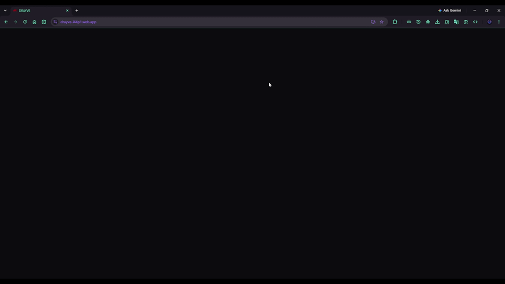

</div>

### 1. Landing Page — 2026 F1 Drivers Hub, Live Search & Team Filter
Menampilkan kartu pembalap dengan efek **3D Perspective Tilt**, pencahayaan *radial spotlight*, filter 11 tim F1 2026, fitur *Favorite*, serta **iOS Liquid Glassmorphism Navbar**.

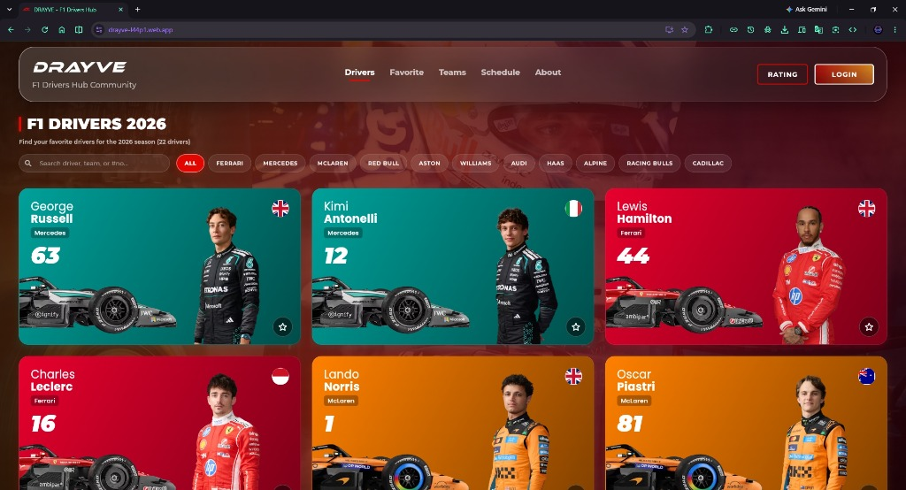

### 2. Constructors Championship (F1 Teams 2026) & Team Profile Detail
Direktori 11 konstruktor F1 2026 lengkap dengan visualisasi mobil berpola *halftone*, serta halaman detail tim yang menampilkan sasis, *power unit*, *speed-stripe* miring, dan poin konstruktor *live* dari API.

| F1 Teams 2026 Showcase | Constructor Team Profile & Chassis Detail |
| :---: | :---: |
| 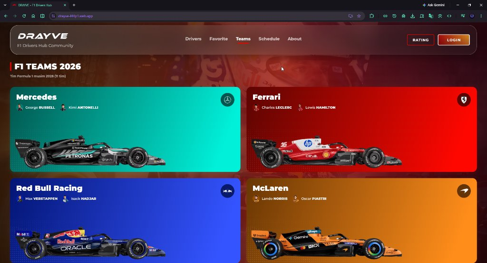 | 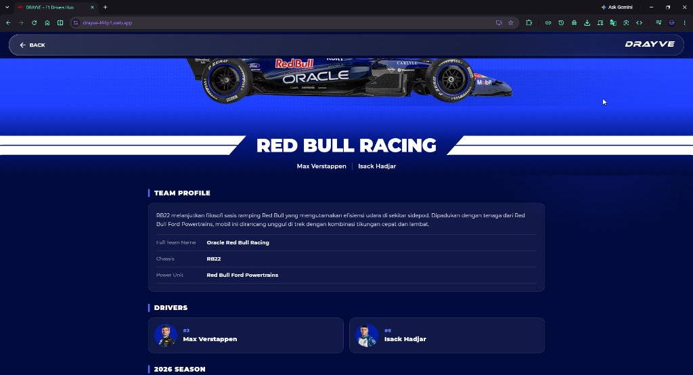 |

### 3. 20-Round Race Calendar, Full Race Classification & Circuit Telemetry
Kalender 20 seri Grand Prix 2026 dengan ringkasan podium (P1–P3), tabel klasifikasi hasil balapan lengkap (P1–P22, Laps, Time/Retired, Points), serta halaman telemetri sirkuit (peta lintasan Interlagos, panjang trek, rekor lap).

| F1 2026 Race Schedule & Podiums | Full Race Classification Table (P1–P22) | Circuit Track Map & Telemetry Stats |
| :---: | :---: | :---: |
| 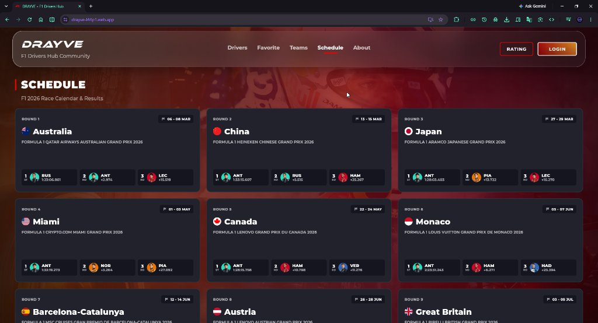 | 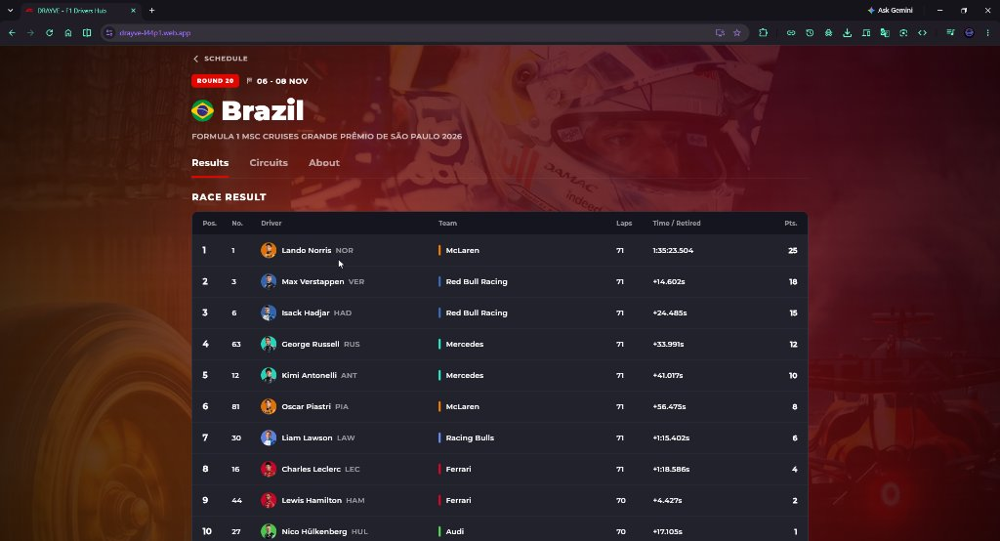 | 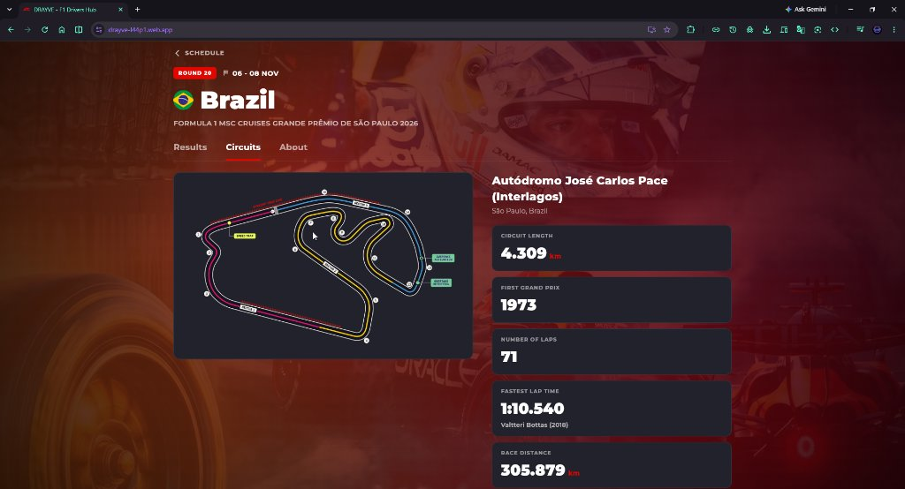 |

### 4. Driver Detail — 5-Axis Telemetry Radar Chart & Career Biography
Halaman profil pembalap dengan *Hero Cutout Banner* bertumpuk, **Radar Chart 5-Sumbu** (*Wins, Podiums, Top 10s, Consistency, Poles*), statistik musim & karier, serta biografi perjalanan karier yang terintegrasi dengan foto berlisensi *Wikimedia Commons*.

| Driver Telemetry & 5-Axis Radar Chart | Career Biography & Wikimedia Integration |
| :---: | :---: |
| 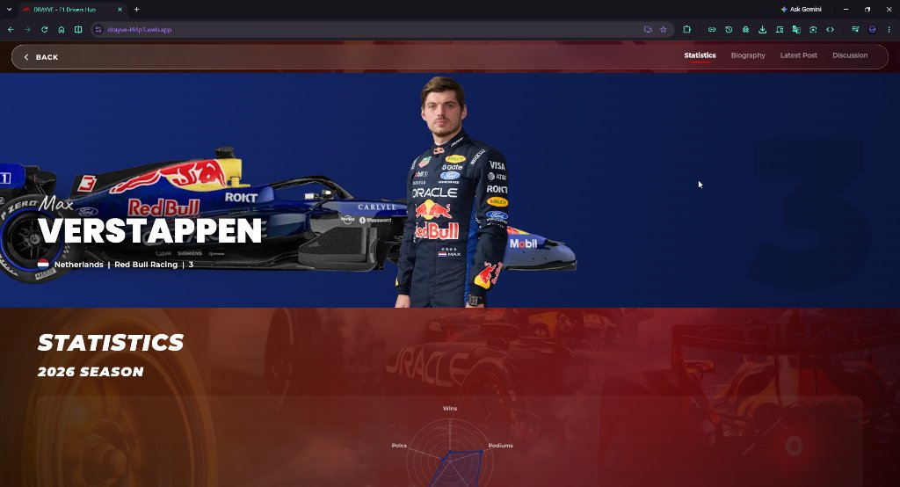 | 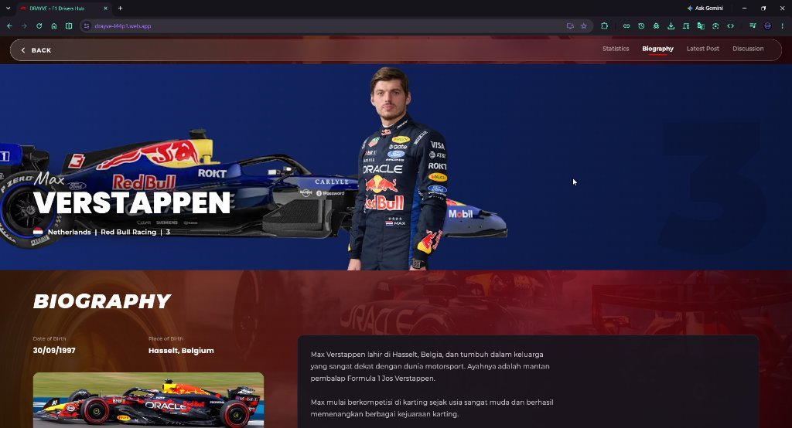 |

### 5. Social Updates & Real-Time Fan Discussion (Cloud Firestore)
Platform interaksi penggemar yang menyediakan *feed* unggahan terbaru pembalap (dilengkapi *PhotoView zoom*) serta ruang obrolan diskusi *real-time* per pembalap menggunakan `StreamBuilder` Firestore.

| Latest Driver Social Updates | Real-Time Fan Discussion Room |
| :---: | :---: |
| 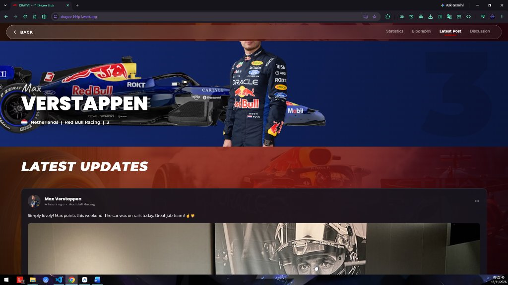 | 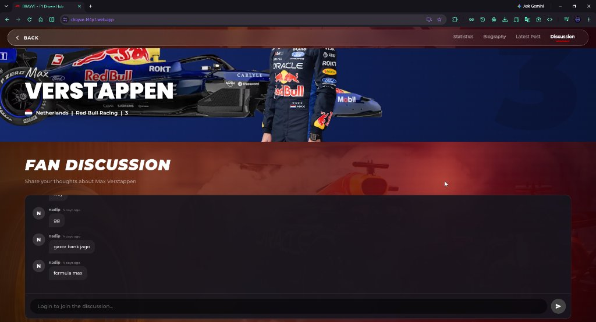 |

### 6. Interactive Creator Card, Smart App Rating & Authentication
Kartu profil tim pengembang interaktif dengan **5-Bar Audio Wave Visualizer** yang bergerak mengikuti status *Play/Pause*, dialog penilaian bintang 5 berbasis Firestore (`app_ratings`), serta halaman autentikasi bergaya *Sliding Overlay*.

| Interactive Music-Style Creator Card | Smart 5-Star App Rating Dialog | Sliding Overlay Login / Sign-Up & OAuth |
| :---: | :---: | :---: |
| 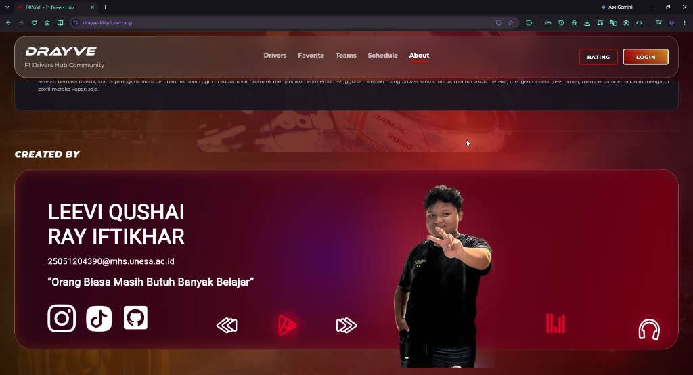 | 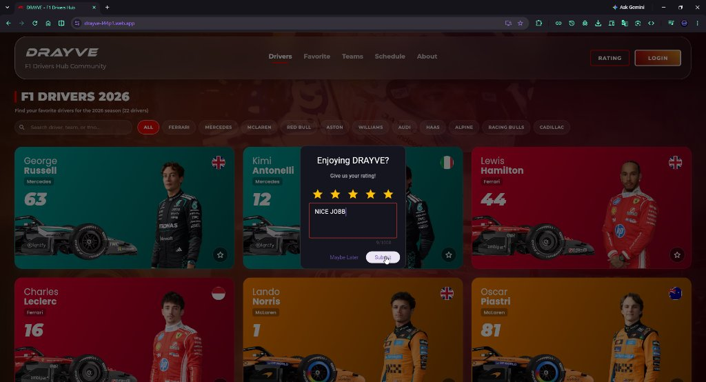 | 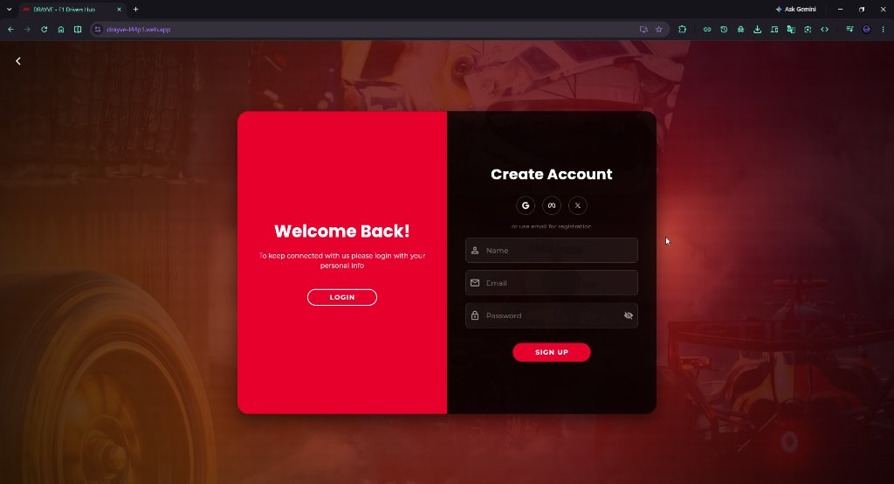 |

---

## 🏆 Sorotan Teknis & Arsitektur (Engineering Highlights)

### 1. 🧱 Penerapan Pilar Object-Oriented Programming (OOP) Murni
Arsitektur model data pada `lib/models/` dirancang mengimplementasikan konsep OOP secara nyata:
* **Inheritance (Pewarisan):** Class `Statistik` (`lib/models/statistik.dart`) mewarisi atribut dan perilaku dasar dari superclass `BioAtlet` (`lib/models/bio_atlet.dart`) menggunakan konstruktor `super.id`, `super.nama`, `super.negara`, `super.fotoAset`, dan `super.fotoUrl`.
* **Encapsulation (Enkapsulasi):** Data klasemen sensitif seperti `_poin`, `_podium`, `_juaraDunia`, `_posisi`, dan `_menang` dideklarasikan sebagai *private fields* dan hanya diakses melalui *getter* serta dimodifikasi melalui *setter* yang memiliki validasi integritas data (`nilaiBaru >= 0`).
* **Polymorphism (Polimorfisme):** Subclass `Statistik` melakukan `@override` terhadap method `tampilkanProfil()` milik `BioAtlet` untuk menghasilkan representasi spesifik pembalap Formula 1 beserta tim, nomor mobil, dan perolehan poinnya.

```dart
// Cuplikan implementasi OOP pada lib/models/statistik.dart
class Statistik extends BioAtlet {
  final String tim;
  final int nomorMobil;
  int _poin; // Private encapsulated field

  int get poin => _poin;
  set poin(int nilaiBaru) {
    if (nilaiBaru >= 0) _poin = nilaiBaru;
  }

  @override
  String tampilkanProfil() {
    return "Pembalap F1: $nama (No. $nomorMobil) dari tim $tim. Total Poin: $_poin";
  }
}
```

### 2. 🌐 Dual REST API Parallel Synchronization & Resilient Caching
Layanan `ApiService` (`lib/services/api_services.dart`) melakukan sinkronisasi paralel menggunakan `Dio` dan `Future.wait` terhadap dua sumber data eksternal sekaligus:
1. **Jolpica F1 API (Ergast Successor):** Menarik klasemen konstruktor (`constructorStandings.json`), klasemen pembalap (`driverStandings.json`), hasil Grand Prix penuh (`results.json`), serta hasil *Sprint Race* (`sprint.json`).
2. **OpenF1 API (`api.openf1.org`):** Menarik foto *headshot* resmi terbaru setiap pembalap dan memodifikasi parameter transformasi Cloudinary (`3col/image.png`) secara dinamis untuk resolusi tinggi.
* **Smart Caching & Graceful Fallback:** Dilengkapi *static Future cache* agar tidak terjadi pemanggilan API berulang saat berganti halaman, normalisasi karakter diakritik/Unicode (`_normalizeKey`), serta *automatic fallback* ke dataset lokal (`lib/data/`) apabila jaringan terputus.

### 3. 🎨 Custom Canvas Rendering, Vector PathMetrics & 3D Matrix Projection
* **Procedural Vector Splash Animation (`lib/pages/splash_screen.dart`):** Animasi pembuka tidak menggunakan aset video/GIF, melainkan dirender secara prosedural menggunakan kurva Bézier (`Path`) pada `_DrayveLogoPainter`. Menggunakan `PathMetric.extractPath` dan `getTangentForOffset` untuk menciptakan efek garis cahaya putih dengan titik pijar (*leading dot*) di ujung tarikan garis sebelum bertransformasi menjadi logo merah F1.
* **3D Perspective Tilt Driver Cards (`lib/widgets/driver_card.dart`):** Kartu pembalap merespons koordinat kursor secara *real-time* menggunakan transformasi perspektif 3D (`Matrix4.identity()..setEntry(3, 2, 0.001)..rotateX(tiltX)..rotateY(tiltY)`) yang dipadukan dengan *radial spotlight gradient* mengikuti posisi mouse.
* **4-Layer Parallax Ambient Background (`lib/widgets/animated_background.dart`):** Digerakkan oleh `Ticker` khusus yang merender *breathing radial blobs*, kolase F1 hemat memori (`cacheWidth: 1920`), serta *cursor glow* aditif (`BlendMode.plus`) yang dihaluskan dengan rumus peluruhan eksponensial.
* **iOS Liquid Glassmorphism (`lib/widgets/custom_navbar.dart`):** Mengombinasikan `BackdropFilter` blur dengan `_GlassBorderPainter` untuk menghasilkan *specular highlight border* layaknya kaca asli.

### 4. 🖥️ Exponential Smooth Scroll Physics & Adaptive Desktop Scaler
* **Custom Scroll Physics (`lib/widgets/smooth_scroll.dart`):** Mengatasi masalah *jumping/stuttering* bawaan *mouse wheel* dan *trackpad* pada Flutter Web dengan membangun `_SmoothScrollPosition` (`ScrollPositionWithSingleContext`). Seluruh delta input diakumulasikan ke satu target dan diinterpolasi setiap frame menggunakan persamaan smoothing eksponensial:
  $$\text{step} = (\text{target} - \text{pixels}) \times \left(1 - e^{-\text{smoothing} \cdot \Delta t}\right)$$
* **Proportional Desktop Viewport Scaler (`lib/main.dart`):** Widget `_DesktopUiScaler` secara otomatis menskalakan tampilan berbasis resolusi desain acuan `1920px` sehingga antarmuka pada laptop dengan *Windows Display Scaling* 125%–150% tetap terlihat proporsional tanpa *overflow*, serta beralih ke mode responsif mobile pada lebar `< 800px`.

### 5. 🔐 Full-Stack Firebase Architecture & Hardened Security Rules
* **"Try Before You Buy" Auth Flow (`lib/providers/auth_provider.dart`):** Menggunakan `Provider` dan stream `FirebaseAuth.instance.authStateChanges()`. Pengunjung bebas mengeksplorasi seluruh statistik, jadwal, dan biografi, namun tindakan interaktif (*Favorite Driver, Like/Comment Post, Live Discussion, App Rating*) akan memicu halaman autentikasi (`AuthPage`) dengan dukungan **Email/Password**, **Reset Password**, serta **Social OAuth (Google, Facebook, X/Twitter)**.
* **Real-Time Fan Discussion (`lib/pages/discussion.dart`):** Ruang obrolan spesifik per pembalap menggunakan `StreamBuilder` Cloud Firestore dengan indikator waktu relatif (`timeago`) dan *avatar caching*.
* **Base64 Serverless Profile Picture (`lib/pages/profile_page.dart`):** Pembaruan foto profil pengguna menggunakan `image_picker` dengan kompresi terukur yang di-encode ke format Base64 langsung ke dokumen Firestore pengguna.
* **Server-Side Firestore Rules (`firestore.rules`):** Aturan keamanan ketat di sisi server yang memvalidasi kepemilikan dokumen (`request.auth.uid == userId`) serta memvalidasi skema, tipe data, rentang nilai (rating 1–5), panjang string (`<= 1000` karakter), dan waktu server (`request.time`) pada koleksi `app_ratings`.

---

## 📦 Modul Fitur Lengkap

| Modul | File Utama | Deskripsi Fitur |
| :--- | :--- | :--- |
| **Drivers Hub & Filter** | `landing_page.dart` | Grid responsif 22 pembalap F1 2026 dengan pencarian *real-time* (nama, tim, nomor mobil), filter per tim, tab *Favorite*, dan efek *Shimmer Skeleton*. |
| **Driver Telemetry & Bio** | `driver_detail_page.dart`, `bio.dart` | *Hero banner* bergradasi sesuai tim, **5-Axis Radar Chart** (`fl_chart`), statistik musim 2026 & karier, serta biografi lengkap dengan foto *Creative Commons* Wikimedia. |
| **Social Updates & Zoom** | `latest_post.dart`, `photo_viewer_page.dart` | Unggahan media sosial pembalap dengan fitur *Like* interaktif dan pratinjau gambar *pinch-to-zoom* (`photo_view`) bertransisi `Hero`. |
| **2026 Teams Showcase** | `teams_page.dart` | Direktori 11 konstruktor F1 2026 (termasuk **Audi** & **Cadillac**), profil sasis & *power unit*, *halftone speed pattern*, dan navigasi langsung ke pembalap. |
| **Race Schedule & Circuits** | `schedule_page.dart`, `race_detail_page.dart` | Kalender 20 seri GP 2026 lengkap dengan podium P1–P3, tabel hasil penuh (P1–P22, Laps, Time/DNF, Points), peta sirkuit, statistik trek, dan FAQ interaktif. |
| **Smart App Rating** | `landing_page.dart` | Pop-up penilaian bintang 5 cerdas yang muncul otomatis setelah 10 kali navigasi menu (dilacak via `SharedPreferences` dengan fitur tunda 7 hari). |
| **Interactive Creator Card** | `aboutme_page.dart` | Kartu profil anggota tim bergaya *Music Player* dengan animasi *staggered slide*, *5-bar audio visualizer*, *beat-pulsing headphones*, dan palet gradien dinamis. |

---

## 📂 Struktur Direktori Proyek

```text
lib/
├── data/
│   ├── bio_karir.dart          # Dataset biografi perjalanan karier 22 pembalap
│   ├── circuit_data.dart       # Koordinat outline & metadata sirkuit F1
│   ├── data.dart               # Dataset utama objek Statistik pembalap 2026
│   ├── data_sosmed.dart        # Data postingan & komentar sosial media pembalap
│   ├── f1_photos.dart          # Repositori URL foto Wikimedia Commons & fallback aset
│   ├── f1_teams.dart           # Dataset 11 konstruktor F1 2026, sasis, & power unit
│   ├── race_detail_data.dart   # Detail sirkuit, rekor lap, & mapping kode pembalap
│   ├── schedule_data.dart      # Kalender 20 balapan 2026 & hasil penuh P1-P22
│   └── statistikv2.dart        # Statistik mendalam musim 2026 (GP + Sprint) & karier
├── models/
│   ├── bio_atlet.dart          # Superclass BioAtlet (Base Model)
│   ├── circuit.dart            # Model data Circuit
│   └── statistik.dart          # Subclass Statistik (Inheritance, Encapsulation, Polymorphism)
├── pages/
│   ├── aboutme_page.dart       # Halaman profil aplikasi & Interactive Creator Card
│   ├── bio.dart                # Tab biografi pembalap
│   ├── discussion.dart         # Tab diskusi penggemar real-time (Cloud Firestore)
│   ├── driver_detail_page.dart # Halaman detail pembalap & 5-Axis Radar Chart
│   ├── landing_page.dart       # Halaman utama, pencarian, filter tim, & sistem rating
│   ├── latest_post.dart        # Tab unggahan sosial pembalap
│   ├── login_signup_page.dart  # Halaman autentikasi (Sliding Desktop UI & Social OAuth)
│   ├── photo_viewer_page.dart  # Halaman zoom gambar interaktif (PhotoView)
│   ├── profile_page.dart       # Manajemen akun & upload avatar Base64
│   ├── race_detail_page.dart   # Halaman detail GP (Tab Results, Circuits, About FAQ)
│   ├── schedule_page.dart      # Halaman kalender balapan 2026
│   ├── splash_screen.dart      # Animasi splash screen prosedural berbasis PathMetric
│   └── teams_page.dart         # Halaman daftar konstruktor & detail tim
├── providers/
│   ├── auth_provider.dart      # State management autentikasi Firebase
│   └── favorite_provider.dart  # State management daftar pembalap favorit
├── services/
│   └── api_services.dart       # Integrasi paralel Jolpica Ergast API & OpenF1 API
├── styles/
│   ├── app_theme.dart          # Konfigurasi tema aplikasi
│   ├── colors.dart             # Konstanta palet warna DRAYVE
│   └── text_styles.dart        # Tipografi standar aplikasi
├── widgets/
│   ├── animated_background.dart# 4-layer parallax background & cursor glow painter
│   ├── custom_navbar.dart      # iOS liquid glassmorphism navbar dengan specular border
│   ├── drayve_network_image.dart# Pemuat gambar lintas platform (Web & Native Cache)
│   ├── drayve_page_route.dart  # Custom page route transition (Fade + Scale)
│   ├── driver_avatar.dart      # Avatar pembalap pintar (OpenF1 Headshot -> Local Fallback)
│   ├── driver_card.dart        # Kartu pembalap 3D tilt & radial spotlight
│   ├── interactive.dart        # Widget animasi RevealOnce & HoverScale
│   └── smooth_scroll.dart      # Custom exponential smooth scroll physics untuk Web
├── firebase_options.dart       # Konfigurasi platform Firebase
└── main.dart                   # Entry point, MultiProvider, & Desktop UI Scaler
```

---

## 🛠️ Teknologi & Packages Utama

* **Framework & Bahasa:** Flutter SDK & Dart (`^3.13.2`)
* **Backend & Cloud:** Firebase Core, Firebase Authentication, Cloud Firestore, Firebase Hosting
* **State Management:** `provider` (`ChangeNotifierProvider`, `Consumer`)
* **Networking & Caching:** `dio`, `cached_network_image`, `shared_preferences`
* **Visualisasi & Animasi:** `fl_chart` (Radar Chart), `flutter_animate`, `shimmer`, `photo_view`
* **Tipografi:** Custom Font `Ethnocentric` & `google_fonts` (`Montserrat`, `Poppins`, `Caveat`)
* **Utilitas:** `image_picker`, `url_launcher`, `timeago`

---

## 👥 Tim Pengembang (Created By)

Proyek ini disusun dan dikembangkan oleh mahasiswa **Universitas Negeri Surabaya (UNESA)**:

| No | Nama Lengkap | NIM / Email Institusi | GitHub | Instagram |
| :-: | :--- | :--- | :--- | :--- |
| 1 | **Leevi Qushai Ray Iftikhar** | `25051204390@mhs.unesa.ac.id` | [@leeviray](https://github.com/leeviray) | [@l.qushai_](https://www.instagram.com/l.qushai_/) |
| 2 | **Akmal Priyatama Fadilah Ramdhan** | `25051204410@mhs.unesa.ac.id` | [@fadilsss-ai](https://github.com/fadilsss-ai) | [@faadills](https://www.instagram.com/faadills) |
| 3 | **Gigih Juang Prananta** | `25051204416@mhs.unesa.ac.id` | [@Gigih-Juang](https://github.com/Gigih-Juang) | [@gihh_jprn](https://www.instagram.com/gihh_jprn) |
| 4 | **Prawira Habib Dewangga** | `25051204394@mhs.unesa.ac.id` | [@dewanggaJunior](https://github.com/dewanggaJunior) | [@dewasawithdewa](https://www.instagram.com/dewasawithdewa/) |
| 5 | **Anggito Satrio Wicaksono** | `25051204428@mhs.unesa.ac.id` | [@anggitosatrio](https://github.com/anggitosatrio) | [@angstrww](https://www.instagram.com/angstrww/) |

---

## 🚀 Cara Menjalankan Secara Lokal

1. **Clone repositori ini:**
   ```bash
   git clone https://github.com/leeviray/DRAYVE_Flutter_Project.git
   cd DRAYVE_Flutter_Project
   ```

2. **Unduh seluruh dependensi paket:**
   ```bash
   flutter pub get
   ```

3. **Jalankan aplikasi (Web / Chrome direkomendasikan untuk pengalaman penuh):**
   ```bash
   flutter run -d chrome
   ```
